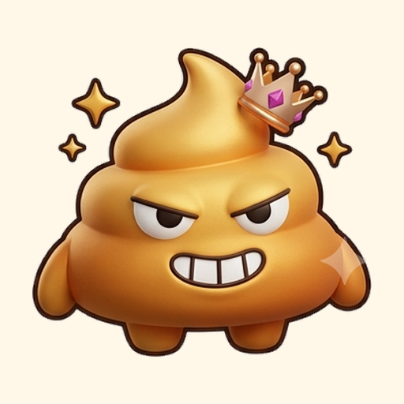
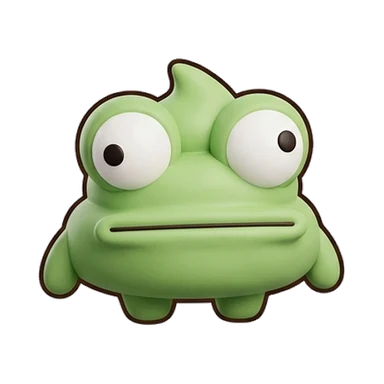
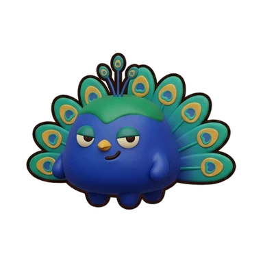
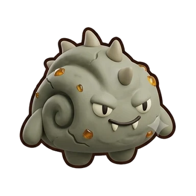

  

<h1 align="center">Poopy</h1>

  A cute idle collection game. Combine feeds, hatch poops, and fill your Poopdex. 
  <b>46 species, 79 recipes, one HTML file.</b>

  <a href="https://poopygame.com">Play</a> |
  <a href="https://poopygame.com/guide.html">Recipe guide</a> |
  <a href="https://poopygame.com/species.html">Poopdex</a> |
  <a href="https://poopygame.com/devlog.html">Devlog</a>

  
  
  
  
  
  

> **한국어 요약.** 사료를 섞어 똥을 부화시키고 도감을 채우는 방치형 수집 게임입니다. 46종과 레시피 79개가 있습니다. 엔진 없이 HTML 파일 하나로 만들었습니다. 가입과 서버 없이 기록은 브라우저에 저장됩니다. 경제 밸런스는 감이 아니라 30일 시뮬레이션으로 맞췄습니다.

## How it was built

- **One file, no engine.** The whole game is a single `index.html` with sprites beside it. No build step, no framework. It loads fast on a phone and works offline once cached.
- **No account, no server.** Saves go to `localStorage`. Nobody collects anything about you, and the game costs nothing to run.
- **Balanced with a simulation, not a hunch.** A script plays thirty simulated days. An ordinary player collects about 32 of 46 species by day thirty and meets the first Legendary on day seven or eight. Two rules came out of it: a failed recipe gives you the grade below, and each consecutive failure on the same recipe adds five percentage points.
- **Sound without sound files.** Every effect is synthesised at runtime with the Web Audio API.
- **Tested headless.** Sixteen test suites with about 480 assertions play the game with a fake DOM. One of them caught a tutorial step that nothing ever advanced.

## What the AI did, and what it did not

The 46 sprites and four backdrops were generated with Google Gemini against a fixed style reference, then hand-picked, background-cleaned and colour-corrected. The code was written with heavy help from Claude.

The design is not AI. The 79 recipes, the grade curve, the pity and consolation rules, the pacing targets and the economy were planned by hand and checked with the simulation.

## Made by

Si Yeongwook ([@062-SIBI](https://github.com/062-SIBI)), solo. Feedback is welcome through [Issues](https://github.com/062-SIBI/poopygame/issues).
